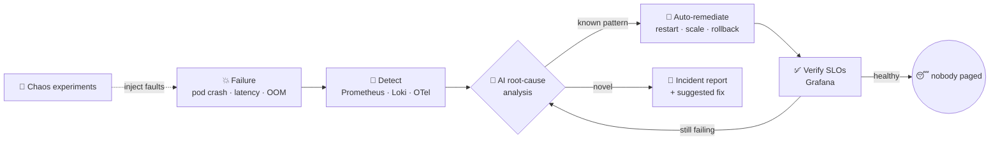
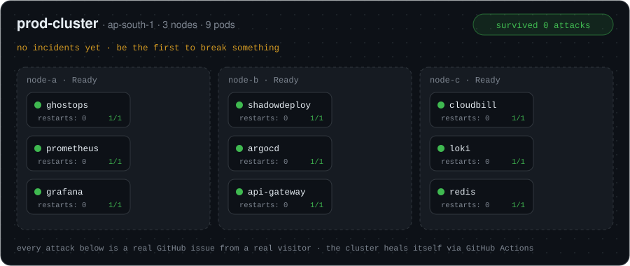

<div align="center">



<br/>

<a href="https://linkedin.com/in/dev-ghildiyal-8777a8329"></a>
<a href="mailto:ghildiyaldev1325@gmail.com"></a>
<a href="https://github.com/DEV-GHILDIYAL?tab=followers"></a>


<sub>⚡ This profile is a running system: the dashboard, activity feed and chaos cluster below are rebuilt by GitHub Actions.</sub>

</div>

## `$ cat dev-ghildiyal.yaml`

```yaml
apiVersion: humans.dev/v1
kind: Engineer
metadata:
  name: dev-ghildiyal
  namespace: mumbai-in
  labels:
    role: devops-engineer
    company: fyntune
    education: cs-graduate        # CGPA 9.02
spec:
  replicas: 1                     # sadly cannot be scaled horizontally
  focus:
    - cloud-infrastructure        # AWS, Terraform
    - kubernetes                  # self-healing clusters
    - ci-cd                       # pipelines that just work
    - observability               # Prometheus, Grafana, Loki, OTel
    - ai-for-ops                  # tools that replace 3am pages
  philosophy: >
    If a human has to do it twice, a pipeline should do it the third time.
  resources:
    requests: { coffee: "3 cups/day", curiosity: "unbounded" }
  livenessProbe:
    exec: { command: ["git", "push"] }
    periodSeconds: 86400
status:
  phase: Running
  conditions:
    - type: OpenToCollaborate
      status: "True"
```

## 🧰 Toolchain

<p align="center">
  
</p>

## 🚀 Workloads in production

<a href="https://github.com/DEV-GHILDIYAL/ghostops"></a>
<a href="https://github.com/DEV-GHILDIYAL/ShadowDeploy"></a>
<a href="https://github.com/DEV-GHILDIYAL/CloudBillAssassin"></a>

<details>
<summary><b>🔍 <code>kubectl describe pod ghostops</code>: how the self-healing loop works</b></summary>
<br/>



</details>

## 🐒 Break my cluster (yes, really)

My whole job is building infrastructure that **survives failure**, so here's a cluster you can attack. Click an attack, then hit **Submit new issue**. A GitHub Action injects the fault, the cluster heals itself, your incident shows up on this profile, and the bot replies with your recovery time.

<p align="center">
  
</p>

<div align="center">

| | 🎯 `ghostops` | 🎯 `shadowdeploy` | 🎯 `cloudbill` | 🎯 `api-gateway` | 🎯 `redis` |
|:--|:--:|:--:|:--:|:--:|:--:|
| 💀 **kill-pod** | [attack](https://github.com/DEV-GHILDIYAL/DEV-GHILDIYAL/issues/new?title=chaos%7Ckill-pod%7Cghostops&body=Just+click+%22Submit+new+issue%22.+The+cluster+will+heal+itself+in+about+a+minute.) | [attack](https://github.com/DEV-GHILDIYAL/DEV-GHILDIYAL/issues/new?title=chaos%7Ckill-pod%7Cshadowdeploy&body=Just+click+%22Submit+new+issue%22.+The+cluster+will+heal+itself+in+about+a+minute.) | [attack](https://github.com/DEV-GHILDIYAL/DEV-GHILDIYAL/issues/new?title=chaos%7Ckill-pod%7Ccloudbill&body=Just+click+%22Submit+new+issue%22.+The+cluster+will+heal+itself+in+about+a+minute.) | [attack](https://github.com/DEV-GHILDIYAL/DEV-GHILDIYAL/issues/new?title=chaos%7Ckill-pod%7Capi-gateway&body=Just+click+%22Submit+new+issue%22.+The+cluster+will+heal+itself+in+about+a+minute.) | [attack](https://github.com/DEV-GHILDIYAL/DEV-GHILDIYAL/issues/new?title=chaos%7Ckill-pod%7Credis&body=Just+click+%22Submit+new+issue%22.+The+cluster+will+heal+itself+in+about+a+minute.) |
| 🔥 **cpu-spike** | [attack](https://github.com/DEV-GHILDIYAL/DEV-GHILDIYAL/issues/new?title=chaos%7Ccpu-spike%7Cghostops&body=Just+click+%22Submit+new+issue%22.+The+cluster+will+heal+itself+in+about+a+minute.) | [attack](https://github.com/DEV-GHILDIYAL/DEV-GHILDIYAL/issues/new?title=chaos%7Ccpu-spike%7Cshadowdeploy&body=Just+click+%22Submit+new+issue%22.+The+cluster+will+heal+itself+in+about+a+minute.) | [attack](https://github.com/DEV-GHILDIYAL/DEV-GHILDIYAL/issues/new?title=chaos%7Ccpu-spike%7Ccloudbill&body=Just+click+%22Submit+new+issue%22.+The+cluster+will+heal+itself+in+about+a+minute.) | [attack](https://github.com/DEV-GHILDIYAL/DEV-GHILDIYAL/issues/new?title=chaos%7Ccpu-spike%7Capi-gateway&body=Just+click+%22Submit+new+issue%22.+The+cluster+will+heal+itself+in+about+a+minute.) | [attack](https://github.com/DEV-GHILDIYAL/DEV-GHILDIYAL/issues/new?title=chaos%7Ccpu-spike%7Credis&body=Just+click+%22Submit+new+issue%22.+The+cluster+will+heal+itself+in+about+a+minute.) |
| 🌩️ **net-chaos** | [attack](https://github.com/DEV-GHILDIYAL/DEV-GHILDIYAL/issues/new?title=chaos%7Cnet-chaos%7Cghostops&body=Just+click+%22Submit+new+issue%22.+The+cluster+will+heal+itself+in+about+a+minute.) | [attack](https://github.com/DEV-GHILDIYAL/DEV-GHILDIYAL/issues/new?title=chaos%7Cnet-chaos%7Cshadowdeploy&body=Just+click+%22Submit+new+issue%22.+The+cluster+will+heal+itself+in+about+a+minute.) | [attack](https://github.com/DEV-GHILDIYAL/DEV-GHILDIYAL/issues/new?title=chaos%7Cnet-chaos%7Ccloudbill&body=Just+click+%22Submit+new+issue%22.+The+cluster+will+heal+itself+in+about+a+minute.) | [attack](https://github.com/DEV-GHILDIYAL/DEV-GHILDIYAL/issues/new?title=chaos%7Cnet-chaos%7Capi-gateway&body=Just+click+%22Submit+new+issue%22.+The+cluster+will+heal+itself+in+about+a+minute.) | [attack](https://github.com/DEV-GHILDIYAL/DEV-GHILDIYAL/issues/new?title=chaos%7Cnet-chaos%7Credis&body=Just+click+%22Submit+new+issue%22.+The+cluster+will+heal+itself+in+about+a+minute.) |
| 🧨 **oom** | [attack](https://github.com/DEV-GHILDIYAL/DEV-GHILDIYAL/issues/new?title=chaos%7Coom%7Cghostops&body=Just+click+%22Submit+new+issue%22.+The+cluster+will+heal+itself+in+about+a+minute.) | [attack](https://github.com/DEV-GHILDIYAL/DEV-GHILDIYAL/issues/new?title=chaos%7Coom%7Cshadowdeploy&body=Just+click+%22Submit+new+issue%22.+The+cluster+will+heal+itself+in+about+a+minute.) | [attack](https://github.com/DEV-GHILDIYAL/DEV-GHILDIYAL/issues/new?title=chaos%7Coom%7Ccloudbill&body=Just+click+%22Submit+new+issue%22.+The+cluster+will+heal+itself+in+about+a+minute.) | [attack](https://github.com/DEV-GHILDIYAL/DEV-GHILDIYAL/issues/new?title=chaos%7Coom%7Capi-gateway&body=Just+click+%22Submit+new+issue%22.+The+cluster+will+heal+itself+in+about+a+minute.) | [attack](https://github.com/DEV-GHILDIYAL/DEV-GHILDIYAL/issues/new?title=chaos%7Coom%7Credis&body=Just+click+%22Submit+new+issue%22.+The+cluster+will+heal+itself+in+about+a+minute.) |

</div>

#### 🚨 Incident board

<!-- CHAOS:START -->
| incident | chaos agent | attack | how it self-healed | MTTR |
|:--|:--|:--|:--|--:|
| — | *you?* | the cluster is suspiciously calm | — | — |

**Top chaos agents:** *empty — claim the top spot*
<!-- CHAOS:END -->

<sub>Also targetable by hand: <code>prometheus</code>, <code>grafana</code>, <code>argocd</code>, <code>loki</code>. Title format: <code>chaos|&lt;action&gt;|&lt;pod&gt;</code>.</sub>

## 📊 Observability

<p align="center">
  
</p>

#### 📜 `kubectl logs -f dev-ghildiyal --tail=6`

<!-- ACTIVITY:START -->
| timestamp (IST) | | event |
|:--|:-:|:--|
| `Oct 24 · 01:32` | 🚀 | pushed 6 times to [fundednext-trading-bot](https://github.com/DEV-GHILDIYAL/fundednext-trading-bot) |
| `Oct 23 · 15:26` | 🔀 | opened a pull request in [fundednext-trading-bot](https://github.com/DEV-GHILDIYAL/fundednext-trading-bot) |
| `Oct 23 · 15:05` | 🌱 | created branch `feature/mt5-bridge-groq-cicd` in [fundednext-trading-bot](https://github.com/DEV-GHILDIYAL/fundednext-trading-bot) |
| `Oct 23 · 01:48` | 🚀 | pushed 10 times to [fundednext-trading-bot](https://github.com/DEV-GHILDIYAL/fundednext-trading-bot) |
| `Oct 20 · 22:58` | 🚀 | pushed to [SONIQ](https://github.com/DEV-GHILDIYAL/SONIQ) |
| `Oct 20 · 15:24` | ⭐ | starred [SONIQ](https://github.com/DEV-GHILDIYAL/SONIQ) |
<!-- ACTIVITY:END -->

## 🐍 Contribution graph, consumed

<p align="center">
  <picture>
    <source media="(prefers-color-scheme: dark)" srcset="https://raw.githubusercontent.com/DEV-GHILDIYAL/DEV-GHILDIYAL/output/github-contribution-grid-snake-dark.svg" />
    <source media="(prefers-color-scheme: light)" srcset="https://raw.githubusercontent.com/DEV-GHILDIYAL/DEV-GHILDIYAL/output/github-contribution-grid-snake.svg" />
    
  </picture>
</p>

<details>
<summary><b>🥚 <code>$ sudo rm -rf / --no-preserve-root</code></b></summary>
<br/>

```console
[sudo] password for visitor: ********
visitor is not in the sudoers file. This incident will be reported.

  ✋ Nice try. This profile is protected by:
     • RBAC (you're a viewer)
     • a PodDisruptionBudget of 1
     • GhostOps, which would have healed it anyway

  Try the chaos table above instead, it's legal there. 🐒
```

</details>

<div align="center">

<sub>Built with hand-written SVG, Python & GitHub Actions. No third-party stats servers were harmed. · <a href="https://github.com/DEV-GHILDIYAL/DEV-GHILDIYAL">view source</a></sub>


</div>
